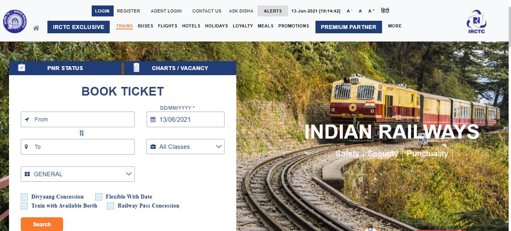
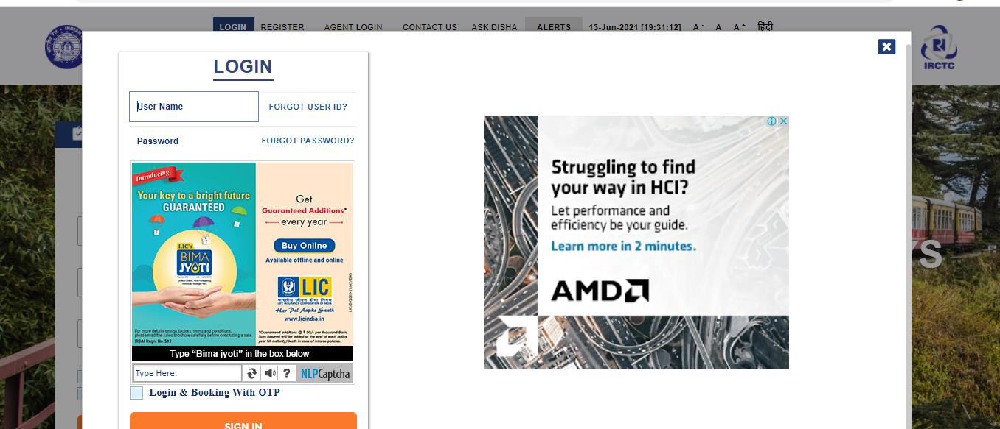
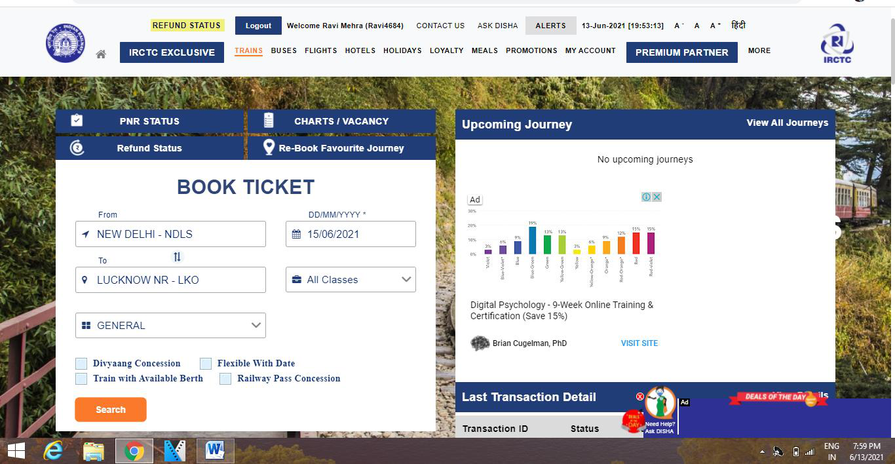
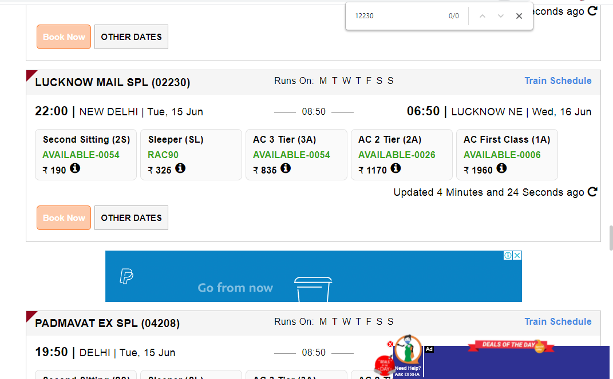
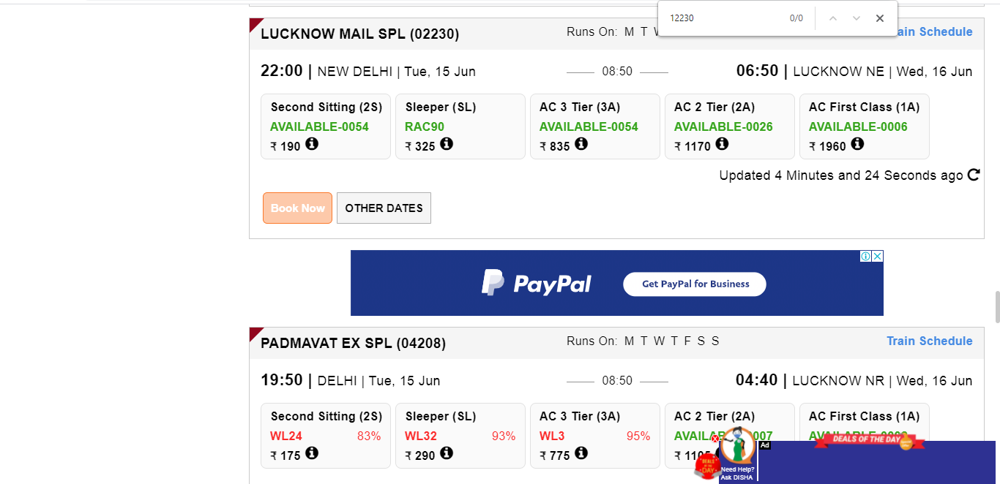
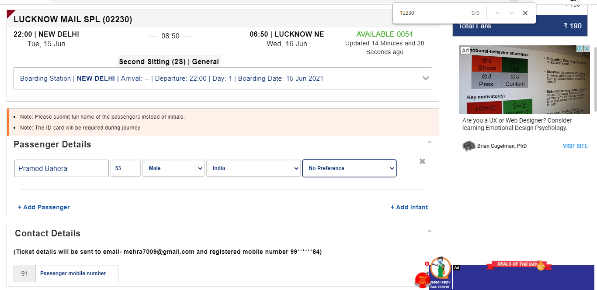
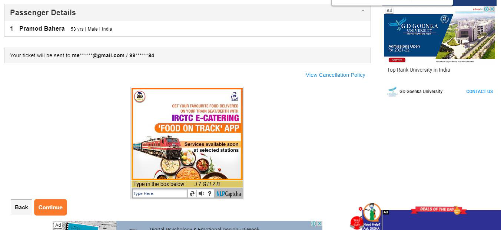
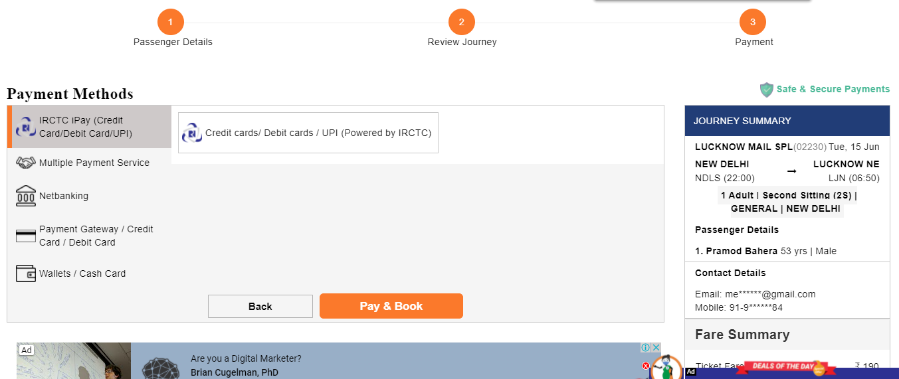
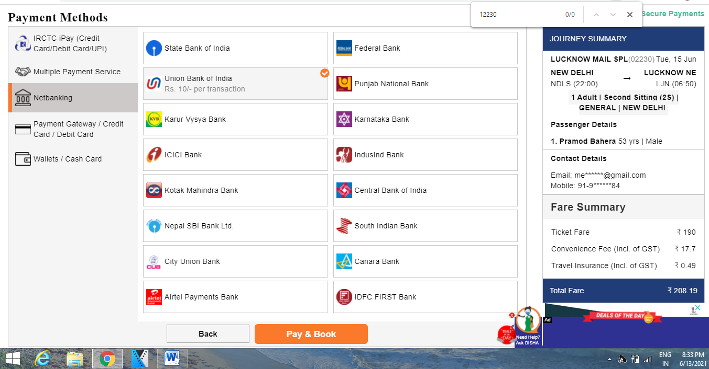
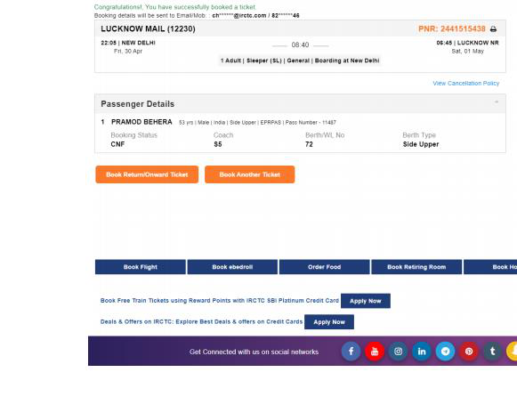

# User Guide E-Ticket Booking

## Page 1

User Guide: Booking E-Ticket

- • Register as an individual. Registration is FREE.

 Login by entering your User name and Password.

## Page 2

- • Provide your desired From - To station, Date of Journey and Class of travel.  
• In case, you do not have any fixed date of journey, select “Flexible with Date” option.  
• Divyaang passengers should select “Divyaang” option to avail corresponding benefits.  
• To find train list, click on "Search" option.

 The next page displays the list of trains available for the selected route. 
 If you wish to know the route and the timings, click on Train Schedule link.  
  To select the train from the train list, click on the type of class available in the selected train. 
 The fare appearing is for a single adult passenger.

## Page 3

- • To book e-ticket in the selected train, click on “Book Now” button.  
• Passenger Reservation Page will appear; check whether the train name, station names, class 
and journey date displayed on the page are same as desired by you. 
 • Enter the Name of the Passengers, Age, Gender, Berth Preference etc. details for each 
passenger.  
• The maximum length of names should be restricted to 16 characters. If the Passenger is a 
senior citizen (60 years and above for male and 58 years and above for female) and wants to 
avail Senior Citizens' concession (40% of Base fare for male and 50% of base fare for female), 
select the avail concession from the drop down list. Senior citizens are requested to carry 
some proof of age in original during their journey. The allotment of your required berth 
depends on the availability.  
• After providing correct details, click on “Continue” button. To change any details related to 
Train, Class, Quota etc. “Back” button may be used.

## Page 4

- • The ticket details, Total fare (including GST & Convenience Fee) and availability of berths at the 
particular time appear on the screen.  
• To change any details related to Passengers, Back button may be used.  
• After checking all details, click on Continue button for Payment process

- • All payment options are grouped under specific categories (viz. Credit cards, Net banking, 
Wallets and Multiple payment service etc.) 
• Select the desired payment option from the displayed Payment Gateway menus. 
 • Click on "Pay & Book" button for redirection to selected Bank website.

## Page 5

- • After successful payment and booking of accommodations, Ticket Confirmation Page will 
appear.

## Page 6

